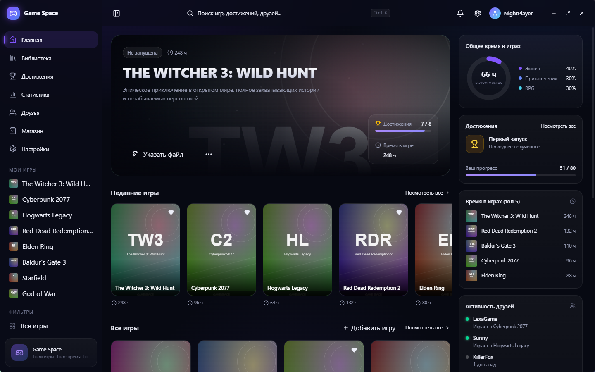
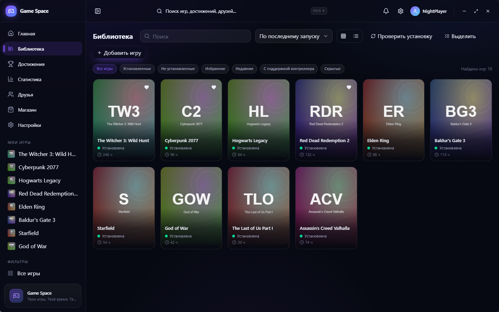
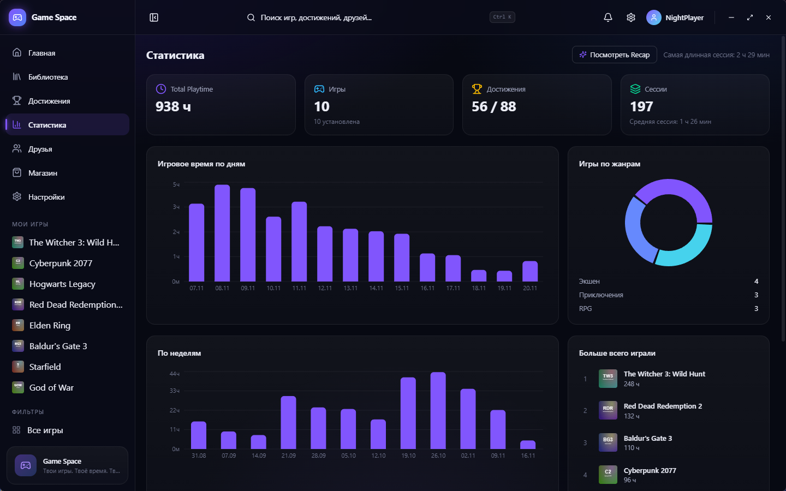
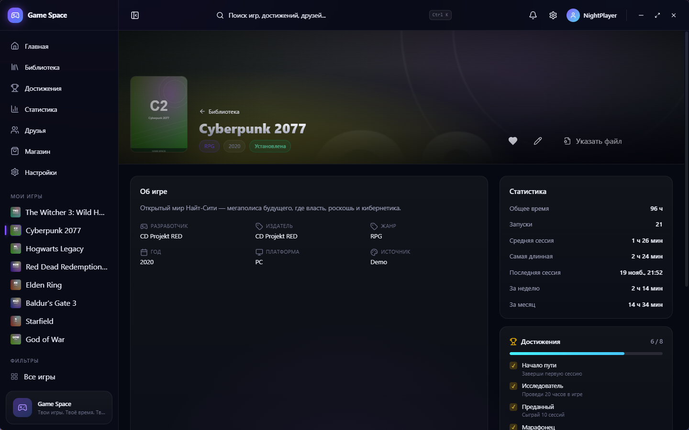
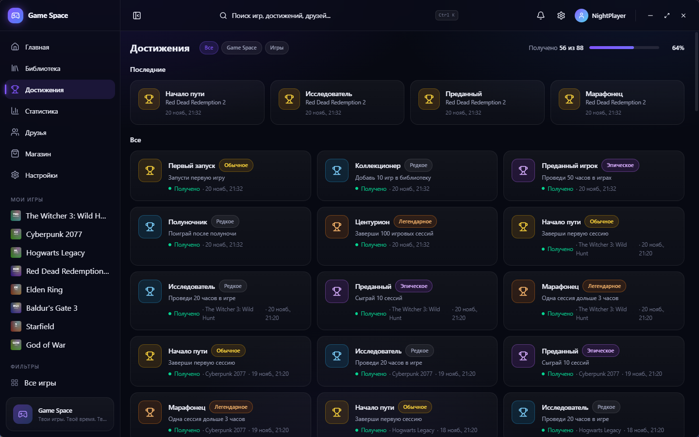
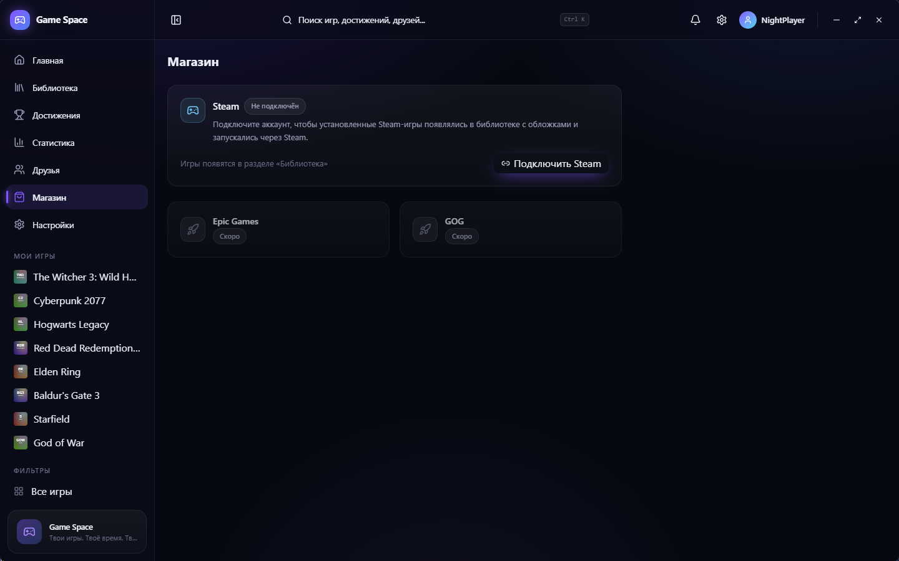
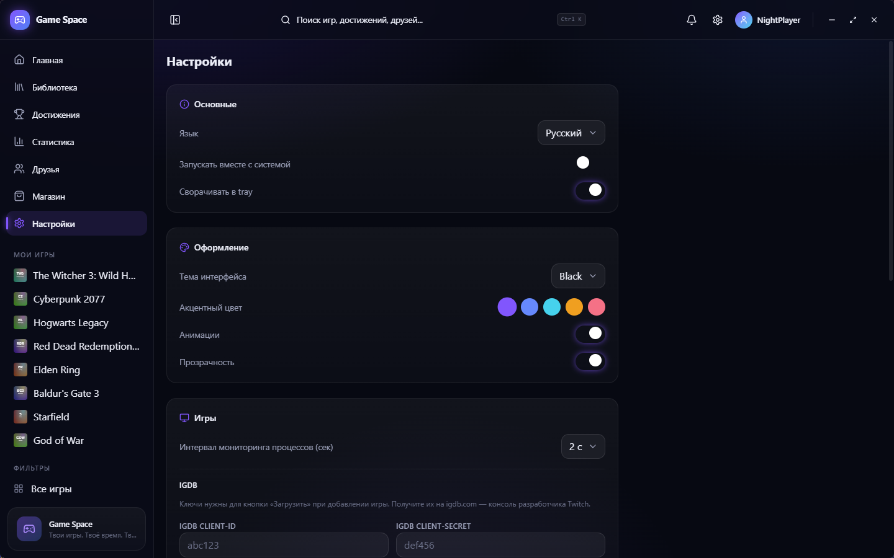
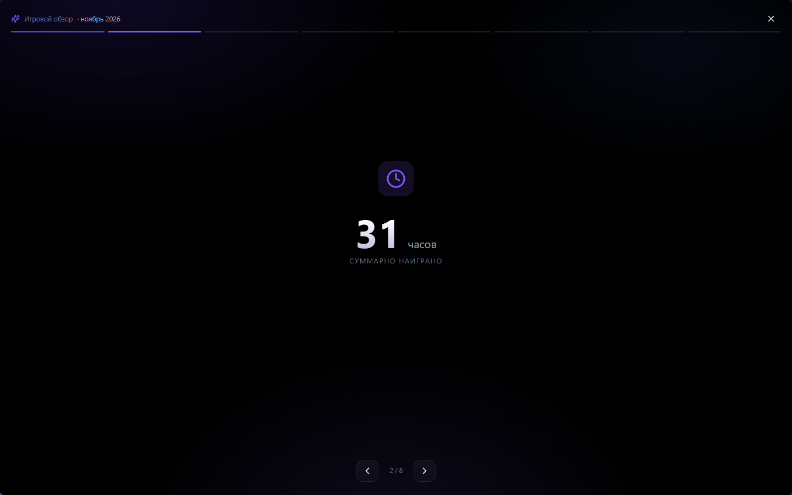

<div align="center">


# Game Space

**Твои игры. Твоё время. Твоя вселенная.**

Быстрый и красивый десктопный лаунчер и библиотека игр для Windows —
с учётом игрового времени, статистикой, достижениями и личным игровым *обзором*.

[](https://tauri.app)
[](https://rust-lang.org)
[](https://react.dev)
[](https://typescriptlang.org)
[](https://tailwindcss.com)
[](https://sqlite.org)
[](https://vite.dev)

[English](README.md) · [Русский](README-RU.md)



</div>

## Что такое Game Space?

Game Space собирает всю вашу коллекцию ПК-игр в одном месте: добавляйте игры вручную или
синхронизируйте библиотеку Steam, запускайте что угодно в один клик — а приложение в фоне
тихо учитывает игровое время. Каждая сессия наполняет живую статистику, открывает достижения
и собирает **Игровой обзор** в духе Spotify Wrapped — персональную слайд-презентацию вашего
игрового месяца или года.

Все данные остаются локально: игры, сессии, статистика и настройки хранятся в одной базе
SQLite на вашем компьютере. Без аккаунтов и телеметрии.

## ✨ Возможности

### 🎮 Библиотека
- **Добавляйте любые игры** — укажите исполняемый файл или найдите игру в [IGDB](https://www.igdb.com), чтобы автоматически подтянуть обложку, описание, разработчика, издателя, жанр и год выхода
- **Синхронизация со Steam** — привяжите аккаунт и импортируйте библиотеку с обложками и уже накопленным игровым временем
- Фильтры (установленные, избранное, недавние, с поддержкой контроллера, скрытые), режимы сетки и списка, сортировка, массовые действия
- Избранное, индивидуальные акцентные темы игр, миниатюры обложек

### 🚀 Запуск и игровое время
- Запуск любой игры в один клик; игры Steam запускаются через нативный протокол `steam://`
- Фоновый мониторинг процессов видит, что игра запущена, открывает сессию и закрывает её при выходе — общее время считается автоматически, по каждой игре и каждой сессии
- Живой индикатор «В игре» с таймером прямо на главном экране

### 📊 Статистика
- Общее время, число сессий, самая длинная сессия, количество игр
- Графики времени по дням и неделям, распределение по жанрам, топ-5 игр

### 🏆 Достижения
- Локальная система достижений с уровнями редкости (обычное / редкое / эпическое / легендарное)
- Отслеживание прогресса, лента последних полученных и уведомления на рабочем столе

### 🎞 Игровой обзор (Recap)
- Анимированная слайд-презентация за **месяц** или **год**
- Общее время, топ игр, любимые жанры, достижения и карта активности

### 🧩 Интеграции
- Steam (подключён) — синхронизация библиотеки, аватар и данные профиля
- Epic Games и GOG — в планах

### 🖥 Возможности приложения
- Безрамочное окно с собственными элементами управления, системный трей, автозапуск
- Глобальный поиск (`Ctrl+K`) по играм, достижениям и друзьям
- Встроенный обновлятор (проверка → загрузка → установка и перезапуск)
- Экспорт / импорт всех данных в JSON, демо-данные, сброс данных
- Интерфейс на **русском** и **английском**, тёмная тема, акцентные цвета, переключатели анимаций и прозрачности

## 📸 Скриншоты

| Библиотека | Статистика |
| --- | --- |
|  |  |
| **Страница игры** | **Достижения** |
|  |  |
| **Интеграции** | **Настройки** |
|  |  |

**Игровой обзор (Recap)** — персональный отчёт об игровом месяце в духе Spotify Wrapped,
с анимированными счётчиками и забавными фактами:



## 🛠 Технологии

| Слой | Технология |
| --- | --- |
| Оболочка | [Tauri 2](https://tauri.app) (Rust), WebView2 |
| Интерфейс | React 19, TypeScript 5, Tailwind CSS 4 |
| Состояние | Zustand 5 |
| Анимации и графики | Framer Motion, Recharts |
| Хранение | SQLite (версионированные SQL-миграции) |
| Инструменты | Vite 6 |

## 🚀 Начало работы

### Требования
- **Windows 10/11** с WebView2 Runtime (предустановлен в Windows 11)
- [Node.js](https://nodejs.org) 18+ (рекомендуется 20 LTS)
- [Rust](https://rustup.rs) stable с toolchain MSVC

### Запуск в режиме разработки

```bash
git clone https://github.com/AlexWT1/game-sapce.git
cd game-space
npm install
npm run tauri dev
```

### Сборка релиза

```bash
npm run tauri build
```

Установщики собираются в `src-tauri/target/release/bundle/`.

### Дополнительные интеграции
- **Метаданные IGDB** — бесплатные ключи из [Twitch Developer Console](https://dev.twitch.tv/console) (Client-ID / Client-Secret), указываются на странице настроек
- **Синхронизация Steam** — бесплатный ключ [Steam Web API](https://steamcommunity.com/dev/apikey) и ссылка на профиль, на странице «Магазин»

## 📁 Структура проекта

```
├── src/                  # React-фронтенд
│   ├── pages/            # Главная, Библиотека, Статистика, Обзор, Магазин, …
│   ├── features/         # модули игр / обзора / магазина
│   ├── components/       # UI-компоненты
│   ├── stores/           # сторы на Zustand
│   ├── services/         # обёртки над Tauri IPC
│   └── i18n/             # словари RU / EN
├── src-tauri/            # Rust-бэкенд
│   └── src/
│       ├── commands/     # обработчики IPC-команд
│       ├── services/     # Steam, IGDB, экспорт, обновления
│       ├── process/      # мониторинг игровых процессов
│       ├── database/     # слой SQLite
│       └── tray/         # системный трей
├── migrations/           # SQL-миграции схемы БД
└── scripts/              # утилиты для разработки
```

---

<div align="center">
Сделано с ❤️ и Tauri
</div>
