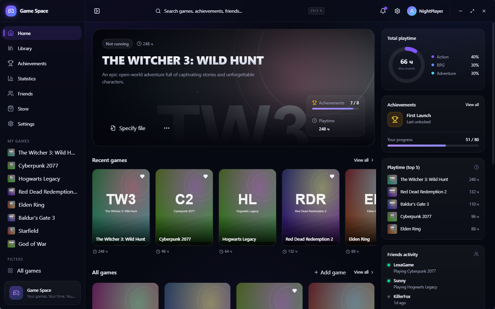
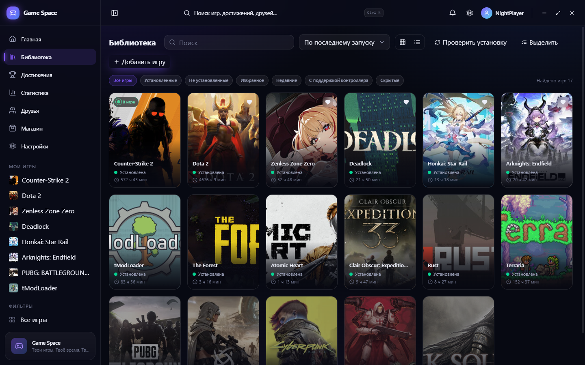
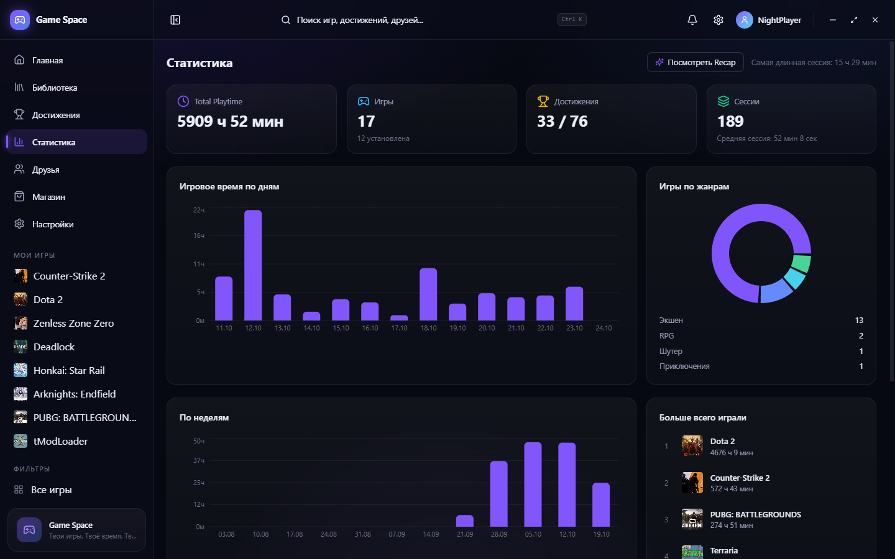
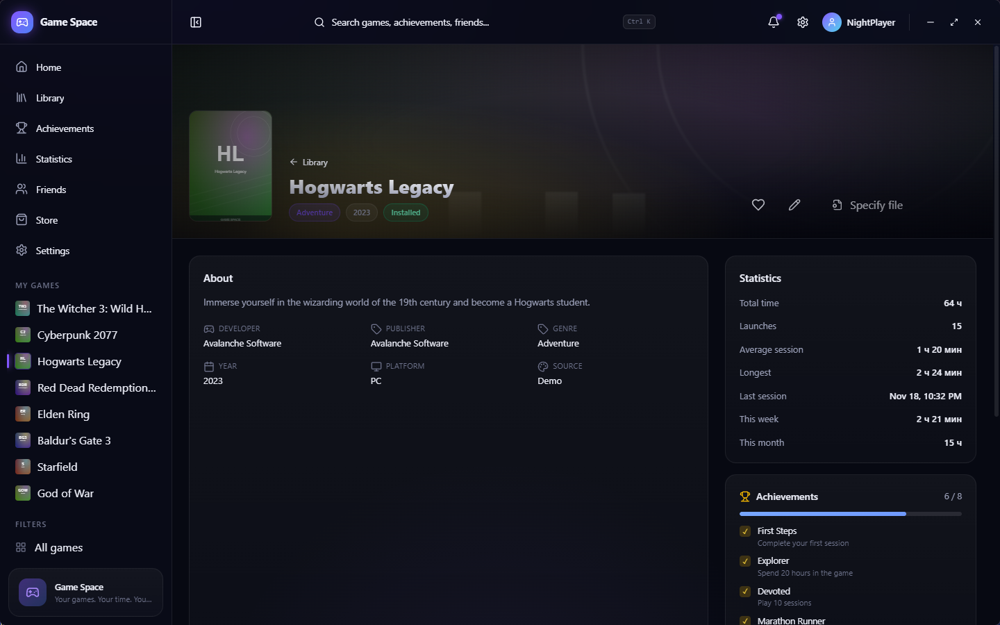
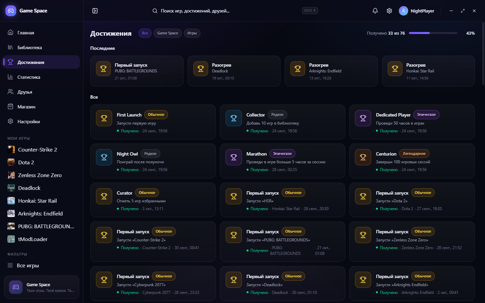
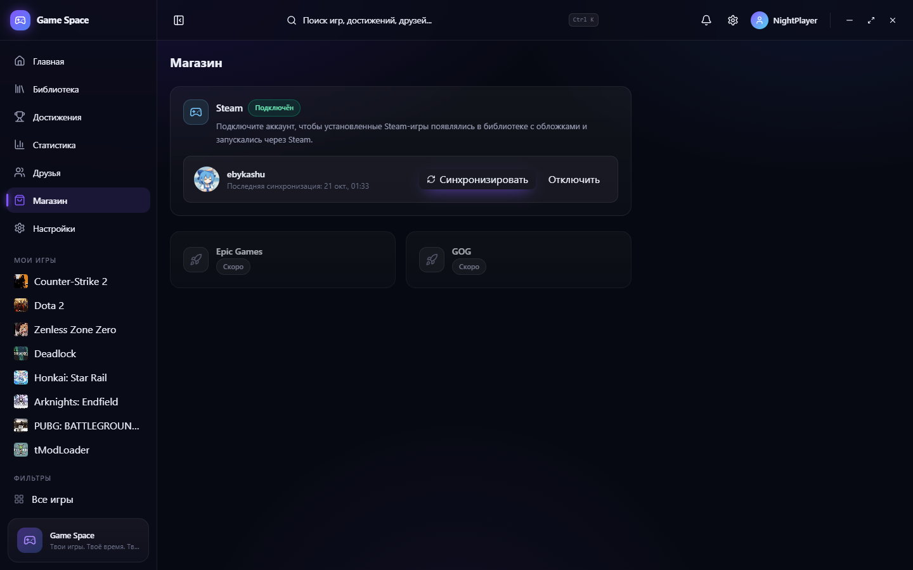
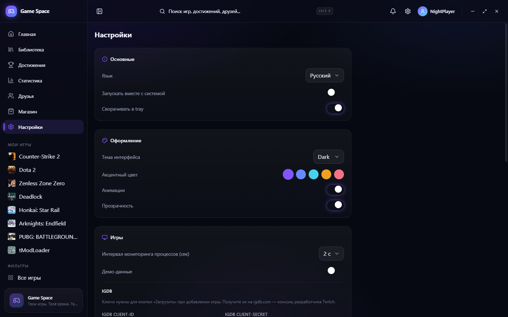
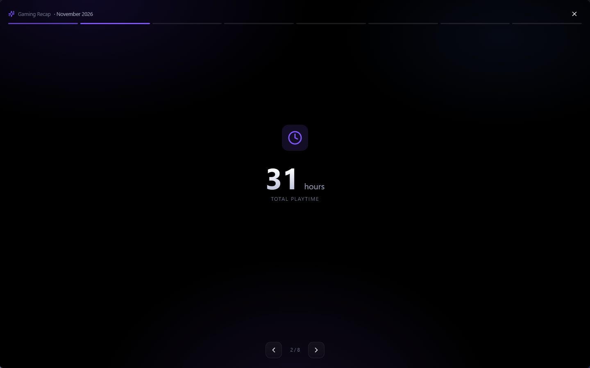

<div align="center">


# Game Space

**Your games. Your time. Your universe.**

A fast, beautiful desktop game library & launcher for Windows —
with playtime tracking, statistics, achievements and a personal gaming *Recap*.

[](https://tauri.app)
[](https://rust-lang.org)
[](https://react.dev)
[](https://typescriptlang.org)
[](https://tailwindcss.com)
[](https://sqlite.org)
[](https://vite.dev)

[English](README.md) · [Русский](README-RU.md)



</div>

## What is Game Space?

Game Space brings your entire PC game collection into one place: add games manually or sync your
Steam library, launch anything in a click, and let the app quietly track your playtime in the
background. Every session feeds live statistics, unlocks achievements and builds a Spotify-style
**Recap** — a personal slideshow of your gaming month or year.

All data stays local: games, sessions, statistics and settings live in a single SQLite database
on your machine. No accounts, no telemetry.

## ✨ Features

### 🎮 Library
- **Add any game** — pick an executable, or search [IGDB](https://www.igdb.com) to auto-fill the cover, description, developer, publisher, genre and release year
- **Steam sync** — link your Steam account and import your library with covers and existing playtime
- Filters (installed, favorites, recent, controller-supported, hidden), grid & list views, sorting, bulk actions
- Favorites, per-game accent themes, cover thumbnails

### 🚀 Launch & playtime
- One-click launch for any game; Steam titles are launched via the native `steam://` protocol
- Background process monitoring detects when a game is running, starts a session and stops it when you quit — total playtime is tracked automatically, per game and per session
- Live "In game" indicator with a running timer, right on the home screen

### 📊 Statistics
- Total playtime, sessions, longest session, games played
- Daily and weekly playtime charts, genre breakdown, top-5 games

### 🏆 Achievements
- A local achievement system with rarity levels (common / rare / epic / legendary)
- Progress tracking, recent unlocks feed and desktop notifications

### 🎞 Recap
- An animated, slideshow-style personal report for the **month** or the **year**
- Total time, top games, favorite genres, achievements and an activity heatmap

### 🧩 Integrations
- Steam (connected) — library sync, avatar and profile info
- Epic Games (connected) — installed games sync (Launcher v1 & v2), playtime, covers and `com.epicgames.launcher://` launch
- GOG — planned

### 🖥 Desktop experience
- Frameless window with custom controls, system tray, launch on startup
- Global search (`Ctrl+K`) across games, achievements and friends
- Built-in updater (check → download → install & restart)
- Export / import all data as JSON, demo-data mode, data reset
- Interface in **English** and **Russian**, dark theme, accent colors, animation & transparency toggles

## 📸 Screenshots

| Library | Statistics |
| --- | --- |
|  |  |
| **Game details** | **Achievements** |
|  |  |
| **Steam integration** | **Settings** |
|  |  |

**Recap slideshow** — a personal report on your gaming month, Spotify-Wrapped style,
with animated counters and fun facts:



## 🛠 Tech stack

| Layer | Technology |
| --- | --- |
| Desktop shell | [Tauri 2](https://tauri.app) (Rust), WebView2 |
| UI | React 19, TypeScript 5, Tailwind CSS 4 |
| State | Zustand 5 |
| Animation & charts | Framer Motion, Recharts |
| Storage | SQLite (versioned SQL migrations) |
| Tooling | Vite 6 |

## 🚀 Getting started

### Prerequisites
- **Windows 10/11** with WebView2 Runtime (preinstalled on Windows 11)
- [Node.js](https://nodejs.org) 18+ (20 LTS recommended)
- [Rust](https://rustup.rs) stable with the MSVC toolchain

### Run in development mode

```bash
git clone https://github.com/AlexWT1/game-sapce.git
cd game-space
npm install
npm run tauri dev
```

### Build a release

```bash
npm run tauri build
```

Installers are written to `src-tauri/target/release/bundle/`.

### Optional integrations
- **IGDB metadata** — free [Twitch Developer Console](https://dev.twitch.tv/console) credentials (Client-ID / Client-Secret), set on the Settings page
- **Steam sync** — a free [Steam Web API](https://steamcommunity.com/dev/apikey) key and your profile URL, on the Shop page
- **Epic Games sync** — OAuth authorization code on the Shop page (imports installed Epic Games titles, playtime and covers)

## 📁 Project structure

```
├── src/                  # React frontend
│   ├── pages/            # Home, Library, Statistics, Recap, Shop, …
│   ├── features/         # games / recap / shop feature modules
│   ├── components/       # UI components
│   ├── stores/           # Zustand state stores
│   ├── services/         # Tauri IPC wrappers
│   └── i18n/             # RU / EN dictionaries
├── src-tauri/            # Rust backend
│   └── src/
│       ├── commands/     # IPC command handlers
│       ├── services/     # Steam, IGDB, export, updater
│       ├── process/      # game process monitoring
│       ├── database/     # SQLite layer
│       └── tray/         # system tray
├── migrations/           # SQL schema migrations
└── scripts/              # dev utilities
```

---

<div align="center">
Made with ❤️ and Tauri
</div>
